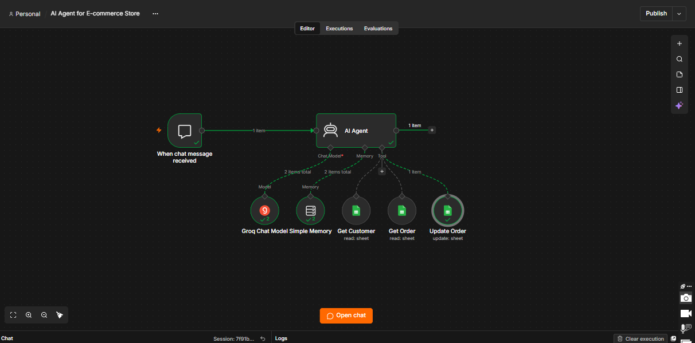
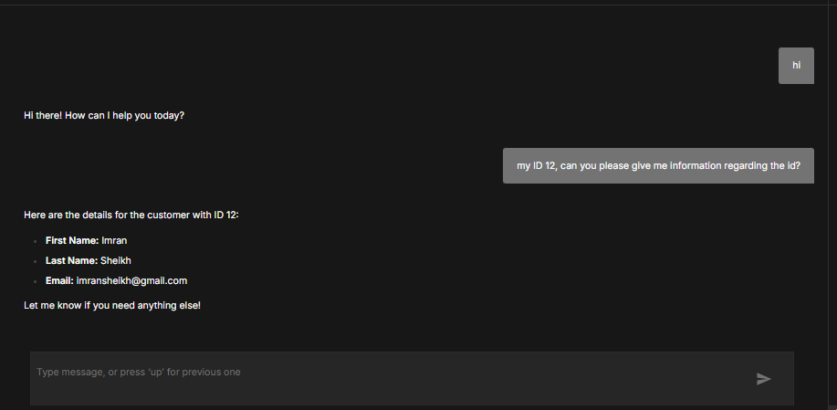
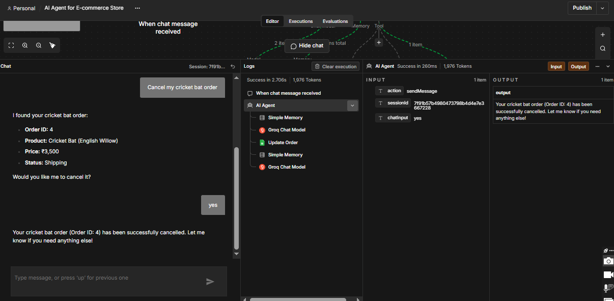

# 🛒 AI Agent for E-commerce Store

An AI-powered customer support and order management solution built with **n8n, Groq, and Google Sheets**.

This project demonstrates how AI agents can streamline e-commerce customer support by understanding customer queries, retrieving customer and order information, and assisting with order status updates through an interactive chat interface.

## 🚀 Project Overview

E-commerce businesses frequently handle repetitive customer questions about orders, customer information, and delivery status. Managing these requests manually can consume valuable time and increase the workload on support teams.

This project introduces an AI-powered assistant that interacts with customers through a chat interface and uses connected Google Sheets tools to retrieve and update relevant information.

The goal is to make customer support more accessible, responsive, and efficient through intelligent workflow automation.

## ✨ Key Features

- **AI-Powered Customer Support:** Interacts with customers through an n8n chat interface and responds to their queries.
- **Customer Information Retrieval:** Searches Google Sheets to retrieve existing customer records.
- **Order Information Retrieval:** Looks up order information using customer IDs.
- **Order Status Management:** Updates an existing order's status through the AI agent.
- **Conversational Memory:** Uses Simple Memory to maintain conversational context.
- **LLM Integration:** Uses Groq with the Qwen model to power the AI agent.
- **Workflow Automation:** Connects AI capabilities with Google Sheets through n8n.

## 🧰 Technology Stack

| Technology | Purpose |
|---|---|
| n8n | Workflow automation and orchestration |
| Groq API | AI model integration |
| Qwen Model | Language model powering the AI agent |
| Google Sheets | Customer and order data management |
| n8n AI Agent | Customer interaction and tool execution |
| Simple Memory | Conversational context management |

## ⚙️ Workflow Architecture

The workflow follows this general process:

1. **Chat Trigger:** Receives a message from the customer through the n8n chat interface.
2. **AI Agent:** Processes the message and determines which action or information is needed.
3. **Groq Chat Model:** Generates intelligent responses.
4. **Simple Memory:** Maintains conversational context.
5. **Google Sheets Tools:** Allows the AI agent to:
   - Retrieve customer information.
   - Retrieve order information.
   - Update an existing order's status.
6. **Chat Response:** Returns the AI-generated response to the customer.

## 🖼️ Workflow Preview

### Complete n8n Workflow



### Customer Information



### Order Information


### Order Cancellation



## 📂 Project Structure

```text
AI-Agent-for-E-commerce-Store/
│
├── AI Agent for E-commerce Store.json
├── WOKFLOW.png
├── customer.png
├── order info.png
├── Cancellation.png
└── README.md
```

## 🛠️ Installation & Setup

Follow these steps to import and configure the workflow.

### 1. Requirements

- An n8n account (Cloud or self-hosted).
- A Groq API key.
- A Google account.
- A Google Sheets database containing customer and order records.

### 2. Clone the Repository

```bash
git clone https://github.com/mujtabamajidgit/AI-Agent-for-E-commerce-Store.git
```

### 3. Import the Workflow into n8n

1. Open your n8n workspace.
2. Create a new workflow.
3. Open the workflow menu.
4. Select **Import from File**.
5. Select `AI Agent for E-commerce Store.json`.

### 4. Configure Groq Credentials

1. Create or access your Groq API account.
2. Generate an API key.
3. Open the Groq Chat Model node in n8n.
4. Add your Groq credentials.
5. Select the configured Qwen model.

### 5. Configure Google Sheets

1. Create your Google Sheets database.
2. Add the required customer and order sheets.
3. Configure Google Sheets OAuth2 credentials in n8n.
4. Connect the relevant spreadsheet and worksheet to the Google Sheets nodes.
5. Verify that the lookup columns match your database structure.

### 6. Test the Workflow

1. Open the n8n chat interface.
2. Send a customer query.
3. Test customer information retrieval.
4. Test order information retrieval.
5. Test an order status update.
6. Verify the results in Google Sheets.

## 📊 Google Sheets Database Structure

The workflow uses two worksheets.

### Customer Sheet

| Column | Description |
|---|---|
| Id | Unique customer identifier |

### Customer Order Sheet

| Column | Description |
|---|---|
| Id | Unique order identifier |
| CustomerId | Associated customer identifier |
| Product Name | Ordered product |
| Price | Product price |
| Order Date | Date the order was placed |
| Delivered Date | Delivery date |
| Status | Current order status |

**Note:** The workflow currently supports customer and order lookups and updating an existing order's status. New customer registration and order creation are not included in the current implementation.

## 🔒 Security & Configuration

- Never upload API keys, passwords, or private credentials.
- Use your own Google Sheets database and OAuth credentials.
- Do not expose private customer information in a public repository.
- Review imported workflow configurations before activating them.

## 🎯 Use Cases

This solution can serve as a foundation for:

- E-commerce customer support automation.
- Customer information assistance.
- Order status inquiries.
- Order management support.
- AI-powered conversational assistants.

## 🔮 Future Improvements

Potential enhancements include:

- New customer registration.
- Automated order creation.
- Product catalogue and inventory lookup.
- Order cancellation with confirmation and validation.
- Delivery tracking integration.
- Human support escalation.
- Customer analytics dashboard.
- Integration with e-commerce platforms.

## 👨‍💻 Author

**Mujtaba Majid Baig**

Software Engineering Student | AI Automation & AI Agent Developer

I build AI-powered automation solutions that help businesses streamline operations, improve customer experiences, and reduce repetitive manual tasks.

- GitHub: [@mujtabamajidgit](https://github.com/mujtabamajidgit)
- Project: [AI Agent for E-commerce Store](https://github.com/mujtabamajidgit/AI-Agent-for-E-commerce-Store)

---

⭐ If you find this project useful, consider giving the repository a star!

**Built with n8n, AI Agents, Groq, and Google Sheets.**
